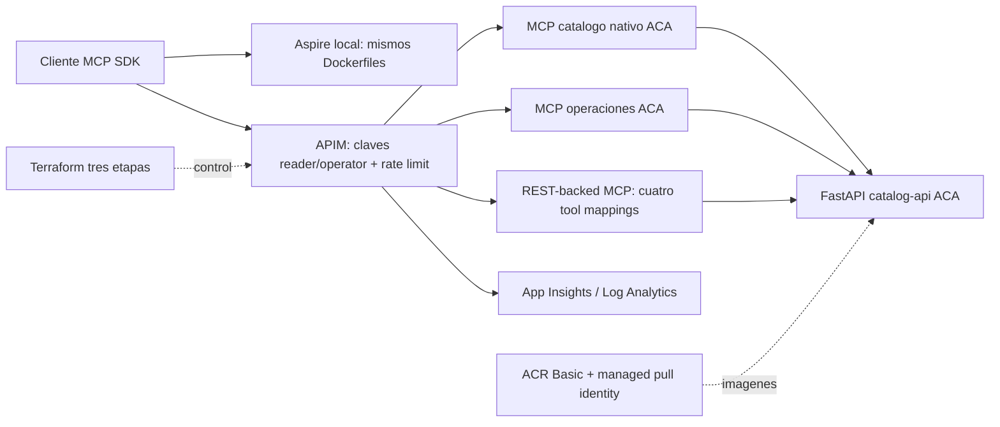

# APIAddicts 2026: catalogo gobernado con MCP

Taller de 45 minutos: **Como usar agentes MCP para construir un catalogo gobernado, seguro y de alto rendimiento**. Descubrir herramientas, gobernar acceso y observar/limitar sobre el mismo dataset corporativo ficticio. El cliente programatico usa el SDK oficial: no necesita LLM comercial, Microsoft Foundry, GitHub Copilot ni licencias adicionales.



## Arquitectura, que / como / por que

| Que | Como | Por que |
|---|---|---|
| Catalogo neutral de APIs | FastAPI/Pydantic, cinco servicios deterministas | Reutilizar descripciones, versiones y contratos |
| Tools descubribles | SDK MCP oficial 1.30.0, Streamable HTTP /mcp | Contratos tipados y tools/list/call, no REST disfrazado |
| Gobierno | APIM Developer, productos reader/operator, rate-limit-by-key | Acceso central, aislamiento y limites por consumidor |
| Dos patrones APIM | Passthrough ACA y REST-backed con tools ARM | Diferenciar propiedad de tools Python y tools APIM |
| Desarrollo repetible | Aspire AddDockerfile y uv.lock root | Mismos contenedores local/cloud |
| Operacion cloud | Terraform AzureRM + AzAPI, ACR digests, ACA | Infraestructura auditable, pull sin passwords |
| Observabilidad y rendimiento | App Insights/KQL, p50/p95 de muestra pequena | Medir controles/latencia, no prometer TPS |

Detalles y compensaciones: [docs/ARCHITECTURE.md](docs/ARCHITECTURE.md), [docs/SECURITY.md](docs/SECURITY.md), [docs/SOURCE_VALIDATION.md](docs/SOURCE_VALIDATION.md). Estado observado y comandos: [docs/EVIDENCE.md](docs/EVIDENCE.md). Un archivo escrito o recurso creado no equivale a prueba PASS.

## Recursos, coste y limites

Un RG nuevo `rg-*apiaddicts*`, ACR Basic, MI de pull/AcrPull, Log Analytics (30 dias, cap 0.1GB/dia), App Insights workspace-based, ACA environment, tres ACA pequenas (0.25 vCPU/0.5GiB), APIM Developer una unidad, REST API, tres MCP, cuatro tools REST-backed, dos productos/suscripciones y diagnostics. Sin Foundry, modelos, Premium, VNet ni recursos compartidos de produccion.

Preflight consulto Sweden Central el 2026-10-12: Developer 0.0658 USD/h, ACR Basic 0.1666 USD/dia. Estimacion indicativa compute/ingesta 5.2848 USD/dia al maximo de replicas, no presupuesto garantizado. Excluye builds, solicitudes, egress, almacenamiento extra e impuestos. Developer cobra mientras exista; credito MVP no significa gratis. TTL es informativo. [Costes y limpieza](docs/COSTS_AND_CLEANUP.md).

Cache oficial de precios regionales hasta seis horas para evitar throttling: WARN muestra su edad y timestamp. Cambiar region/caducar cache exige nueva consulta; si falla, BLOCKED. No se usan tarifas inventadas. Eliminar .local/costs.json fuerza refresh.

SQLite es efimera y el catalogo esta fijado a una replica; no garantiza persistencia entre reinicios/revisiones. Hay deduplicacion transaccional concurrente, no aprobacion real. Origen protegido con secreto compartido ACA/APIM: compromiso didactico, no Entra integrado ni red privada. APIM Developer sin SLA puede tener downtime. API MCP de administracion preview puede diferir de Learn: ver discrepancias contrastadas en SOURCE_VALIDATION.

## Organizacion de scripts

Los puntos de entrada se agrupan por responsabilidad; cada comando conserva sus opciones y su equivalente Bash/PowerShell. Desde la raiz del repositorio:

```text
scripts/
  demo/        demo, local, load, observe; logica de demostracion
  terraform/   preflight, deploy, destroy, assert-subscription, format-policies, export_openapi
  tests/       test-local, test-backends, test-azure
  tools/       configure-mcp, credentials, publish_evidence
  lib/         motor Python, presentacion y helpers compartidos
```

```bash
./scripts/demo/demo.sh --step discover
./scripts/terraform/deploy.sh --what-if
./scripts/tests/test-local.sh --smoke
./scripts/tools/configure-mcp.sh
```

```powershell
./scripts/demo/demo.ps1 -Step discover
./scripts/terraform/deploy.ps1 -WhatIf
./scripts/tests/test-local.ps1 -Smoke
./scripts/tools/configure-mcp.ps1
```

Las rutas planas anteriores se han sustituido por estas carpetas; no hay copias duplicadas de los scripts. En la raiz de scripts solo queda __init__.py para identificar el paquete Python; todos los comandos se ejecutan desde sus subcarpetas. Los helpers encuentran la raiz del repositorio aunque se invoquen desde otro directorio. Las utilidades Python se ejecutan como modulos desde esa raiz: scripts.terraform.export_openapi y scripts.tools.publish_evidence.

Los tests de wrappers ejecutan Bash en Linux y PowerShell en Windows. Consultar ayuda con --help en Bash o -Help en PowerShell; la ayuda de credentials no consulta Azure ni carga claves.

## Prerrequisitos realmente probados

| Herramienta | Version observada/probada |
|---|---|
| Azure CLI | 2.91.0; extension oficial containerapp instalada |
| Terraform | 1.16.5; minimo declarado 1.11, ese minimo no probado |
| AzureRM / AzAPI | 5.9.0 / 2.13.0, locks por modulo |
| .NET SDK / Aspire AppHost y CLI | 10.0.400 / 13.6.0 |
| Python host / contenedor | 3.11.2 / 3.11.14 |
| uv | 0.12.5 |
| Docker Engine | 29.9.0, daemon accesible por usuario |
| PowerShell | 7.6.3 en Linux; Windows 7+ previsto en CI, no afirmar probado en Windows |
| Otros | Git; jq para ejemplos Bash de outputs/credenciales; red a NuGet/PyPI/registries |

Instalar herramientas oficiales. Docker/Podman compatible necesario para Aspire; solo Docker se ha probado. ACR build permite build cloud sin daemon local, no sustituye Docker para LOCAL-01. VS Code/Copilot opcionales. Permisos: crear recursos en RG nuevo, asignar AcrPull a scope registry, providers registrados, leer SKUs/cuotas y keys de las suscripciones APIM del taller. No pedir privilegios nuevos de tenant ni cambiar a otra suscripcion.

```bash
dotnet tool install -g Aspire.Cli --version 13.6.0
export PATH="$PATH:$HOME/.dotnet/tools"
az extension add --name containerapp --upgrade
```

```powershell
dotnet tool install -g Aspire.Cli --version 13.6.0
$env:PATH += [IO.Path]::PathSeparator + "$HOME/.dotnet/tools"
az extension add --name containerapp --upgrade
```

En esta maquina tambien estan en `.local/tools/aspire` y `.local/tools/pwsh`; no son archivos versionados ni requisitos para terceros. Dockerfiles parten del contexto root. Lock autoritativo comun: [uv.lock](uv.lock), no cuatro locks divergentes.

## Obtener y preparar

Repositorio publico: https://github.com/borjapdc/apiaddicts-2026-mcp-workshop.

```bash
git clone https://github.com/borjapdc/apiaddicts-2026-mcp-workshop.git
cd apiaddicts-2026-mcp-workshop
uv sync --frozen
```

```powershell
git clone https://github.com/borjapdc/apiaddicts-2026-mcp-workshop.git
Set-Location apiaddicts-2026-mcp-workshop
uv sync --frozen
```

Las guias y consultas KQL se incluyen en el repositorio. Las evidencias, fixtures y captura del dashboard de cada ejecucion se conservan localmente y se excluyen de Git; no son requisitos para arrancar las aplicaciones. Ejecutar las validaciones de esta guia para comprobar un nuevo clon; los resultados historicos no certifican otra maquina ni otro despliegue.

## Local: un comando

```bash
./scripts/demo/local.sh
```

```powershell
./scripts/demo/local.ps1
```

Equivalente oficial: `aspire run --apphost aspire/AppHost/AppHost.csproj --non-interactive`. Esperar tres contenedores healthy. Dashboard `http://localhost:15888`; catalogo `http://localhost:8001`, MCP read `http://localhost:8002/mcp`, operaciones `http://localhost:8003/mcp`. Aspire enlaza por endpoint/reference y espera /health. No publicar el dashboard local por tuneles. El perfil HTTP permite transporte inseguro SOLO local; se muestra banner explicito. Dashboard puede pedir su token local: no compartirlo.

Smoke y suite, en otra terminal:

```bash
./scripts/tests/test-local.sh --smoke
./scripts/demo/demo.sh --step discover
curl --fail http://localhost:8001/openapi.json
```

```powershell
./scripts/tests/test-local.ps1 -Smoke
./scripts/demo/demo.ps1 -Step discover
Invoke-RestMethod http://localhost:8001/openapi.json
```

Sin Aspire, tres terminales con las MISMAS apps:

```bash
uv run uvicorn app.main:app --app-dir src/catalog-api --port 8001
uv run uvicorn app.main:app --app-dir src/mcp-catalog --port 8002
uv run uvicorn app.main:app --app-dir src/mcp-operations --port 8003
```

Estos comandos tambien funcionan en PowerShell; CATALOG_API_URL por defecto localhost:8001. Requieren cwd root/PYTHONPATH root; ejecutar como `uv run python -m uvicorn` si el shell no encuentra uvicorn. No cloud auth en local. Reiniciar catalogo con DB nueva para reset; el seed read-only nunca cambia. No exponer un endpoint reset inseguro.

## Seleccion Azure y variables

```bash
az account list --all --query '[?state==`Enabled`].{name:name,id:id,tenantId:tenantId}' -o json
./scripts/terraform/assert-subscription.sh
./scripts/terraform/preflight.sh
cp infra/terraform/foundation/terraform.tfvars.example infra/terraform/foundation/terraform.tfvars
cp infra/terraform/workload/terraform.tfvars.example infra/terraform/workload/terraform.tfvars
cp infra/terraform/gateway/terraform.tfvars.example infra/terraform/gateway/terraform.tfvars
```

```powershell
az account list --all --query '[?state==`Enabled`].{name:name,id:id,tenantId:tenantId}' -o json
./scripts/terraform/assert-subscription.ps1
./scripts/terraform/preflight.ps1
Copy-Item infra/terraform/foundation/terraform.tfvars.example infra/terraform/foundation/terraform.tfvars
Copy-Item infra/terraform/workload/terraform.tfvars.example infra/terraform/workload/terraform.tfvars
Copy-Item infra/terraform/gateway/terraform.tfvars.example infra/terraform/gateway/terraform.tfvars
```

El script filtra Enabled y nombre MVP case-insensitive. Una sola candidata: `az account set --subscription <ID detectado>` y verifica tenant con account show; varias o ninguna: BLOCKED, nunca Students. IDs reales van a `.local/target.json` y `detected.auto.tfvars.json` ignorados, providers siempre explicitos. No copiar GUIDs ficticios. Leer los archivos ignorados solo en terminal privada.

Editar estas opciones:

| Opcion | Modulo / comportamiento |
|---|---|
| subscription_id / tenant_id | foundation: se rellenan automaticamente desde MVP; si se edita a otro ID, bloqueo |
| location | foundation: swedencentral por defecto, preflight comprueba region/SKU/precio |
| project | foundation: apiaddicts-mcp, debe conservar apiaddicts |
| environment / owner_alias / instance | foundation: demo / mvp-workshop / 01; nombres sanitizados |
| unique_suffix | foundation: vacio genera random_string persistido, o 6-8 alfanumericos minusculos |
| apim_sku | foundation: Developer; BasicV2 requiere validacion/autoridad de coste adicional y no se aplica automaticamente |
| publisher_email / ttl | foundation: correo de contacto propio si procede / caducidad informativa |
| aca_min_replicas / aca_max_replicas | workload: 1 / 2; catalogo permanece 1 para SQLite |
| rate_limit_calls / rate_limit_period_seconds | gateway: 5 / 30, limites acotados validados |

Scripts propagaran foundation, imagenes y backends a linked.auto.tfvars.json sin copiar outputs manualmente. Nunca regenerar sufijo en workload/gateway. Ejemplo segundo participante: owner_alias="otra-demo", instance="02", unique_suffix="a26mcp02", region disponible. Necesita directorio/state/backend key separado y otro RG. Cambiar nombres sobre el state desplegado provoca reemplazos/gastos; deploy los bloquea, no adopta RG preexistente. ACR elimina guiones; APIM conserva prefijo alfanumerico/guiones.

Nombres observados de esta instancia: RG `rg-apiaddicts-mcp-demo-mvp-workshop-01-b64n92`, APIM `apim-apiaddicts-mcp-demo-mvp-workshop-01-b64n92`, ACR `acrapiaddictsmcpdemomvpworkshop01b64n92`, ACA `ca-cat/ca-read/ca-ops-apia-dem-01-b64n92`, LAW y App Insights prefijos law-/appi-. Obtener nombres exactos mediante output foundation, no reconstruir URLs a ojo.

## Despliegue: un comando, tres etapas

Plan-only por defecto, no genera builds ni Azure:

```bash
./scripts/terraform/deploy.sh --what-if
```

```powershell
./scripts/terraform/deploy.ps1 -WhatIf
```

Primer plan solo puede cubrir foundation; workload/gateway necesitan outputs reales e imagenes. Crear infraestructura autorizada y verificar:

```bash
./scripts/terraform/deploy.sh --apply
```

```powershell
./scripts/terraform/deploy.ps1 -Apply
```

Se persiste primero solo random_string del Terraform state (no Azure); se muestra RG concreto y se rechaza si ya existe. Orden: foundation init/fmt/validate/plan/apply; ACR build 600s max con content hash inmutable; resolver digest; workload apply; smoke read-only readiness/auth; gateway apply; pruebas positivas/negativas; plan final de los tres roots. No null_resource ni local-exec. Config cloud es Terraform; build/push y verificaciones son excepciones explicitas. No hace commit/push.

El plan muestra suscripcion, tenant, region, RG, recursos y coste antes del apply. Exige nuevo RG propio y no borrados/reemplazos. State local ignorado es solo personal; no perderlo. Ver opcion Blob remoto en costes. Una primera creacion Developer puede tardar 30-90 minutos; no usar el provisioning como demo live.

Diagnostico manual (Bash y PowerShell):

```bash
terraform -chdir=infra/terraform/foundation init -input=false
terraform fmt -check -recursive infra/terraform
terraform -chdir=infra/terraform/foundation validate
terraform -chdir=infra/terraform/foundation plan -input=false
terraform -chdir=infra/terraform/workload plan -input=false
terraform -chdir=infra/terraform/gateway plan -input=false
terraform -chdir=infra/terraform/gateway output -json gateway_endpoints
terraform -chdir=infra/terraform/workload output -json backends
terraform -chdir=infra/terraform/foundation output -json foundation
```

Reconstruir/redesplegar un servicio: editar solo su app, ejecutar deploy --apply. El hash de contenido determina build nuevo y Terraform cambia su revision ACA, no APIM foundation. Revisar siempre plan; si cambian shared/lock se reconstruyen todos. Nunca usar latest. El contrato OpenAPI es versionado, regenerar con `uv run python -m scripts.terraform.export_openapi` al cambiar REST y probar `pytest tests/contract`.

## Outputs, acceso y ejemplos

Al editar policies ejecutar `pwsh -File scripts/terraform/format-policies.ps1`: XmlWriter genera la variante REST-MCP y conserva tabs/CRLF del servidor. .gitattributes preserva esa representacion en checkout; no se ignoran cambios de seguridad.

`./scripts/tools/configure-mcp.sh` o `./scripts/tools/configure-mcp.ps1` carga Terraform outputs a `.local/workshop.json` y genera `.vscode/mcp.json` ignorado. Usa inputs password, no keys embebidas. En despliegue parcial esto no certifica operatividad: ejecutar test-azure.

```bash
source scripts/tools/credentials.sh
ENDPOINTS=$(terraform -chdir=infra/terraform/gateway output -json gateway_endpoints)
READ_URL=$(printf '%s' "$ENDPOINTS" | jq -r '."mcp-catalog"')
REST_MCP_URL=$(printf '%s' "$ENDPOINTS" | jq -r '."mcp-catalog-from-rest"')
WRITE_URL=$(printf '%s' "$ENDPOINTS" | jq -r '."mcp-operations"')
uv run python src/mcp-client/client.py --url "$READ_URL"
uv run python src/mcp-client/client.py --url "$READ_URL" --tool get_service --arguments '{"service_id":"payments"}'
uv run python src/mcp-client/client.py --url "$REST_MCP_URL" --tool get_service --arguments '{"service_id":"payments"}'
uv run python src/mcp-client/client.py --url "$WRITE_URL" --key-env APIM_OPERATOR_KEY --tool create_access_request --arguments '{"service_id":"orders","consumer_id":"demo-client","purpose":"Synthetic APIAddicts workshop"}'
```

```powershell
. ./scripts/tools/credentials.ps1
$endpoints = terraform -chdir=infra/terraform/gateway output -json gateway_endpoints | ConvertFrom-Json
uv run python src/mcp-client/client.py --url $endpoints.'mcp-catalog'
uv run python src/mcp-client/client.py --url $endpoints.'mcp-catalog' --tool get_service --arguments '{"service_id":"payments"}'
uv run python src/mcp-client/client.py --url $endpoints.'mcp-operations' --key-env APIM_OPERATOR_KEY --tool create_access_request --arguments '{"service_id":"orders","consumer_id":"demo-client","purpose":"Synthetic APIAddicts workshop"}'
```

No imprimir variables de claves ni usar `set -x`. Los scripts de demo obtienen claves internamente en memoria. Quitar environment al terminar: `unset APIM_READER_KEY APIM_OPERATOR_KEY` o `Remove-Item Env:APIM_READER_KEY,Env:APIM_OPERATOR_KEY`. Origin tokens solo se usan en test-backends, no en clientes normales.

Pruebas: sin key APIM 401/403; reader en WRITE_URL 401/403; operator en write exito; ACA anonimo 401 (health 200); N solicitudes 429 y recuperacion tras ventana. Los codigos reales quedan en evidencia, no asumir codigo exacto antes de observar.

```bash
./scripts/tests/test-backends.sh
./scripts/tests/test-azure.sh
./scripts/demo/demo.sh --step cloud
./scripts/demo/demo.sh --step govern
./scripts/demo/observe.sh
```

```powershell
./scripts/tests/test-backends.ps1
./scripts/tests/test-azure.ps1
./scripts/demo/demo.ps1 -Step cloud
./scripts/demo/demo.ps1 -Step govern
./scripts/demo/observe.ps1
```

El script load cuenta respuestas HTTP MCP, limita la carga y mide initialize+tools/call con concurrencia 1. Indicativo 1500ms, no SLA ni benchmark TPS. Los 429 no son latencias de herramientas exitosas. OBS requiere filas reales con gen_ai.tool.name; ausencia -> BLOCKED. KQL workspace usa AppRequests/Properties/DurationMs, experiencia clasica App Insights usa requests/customDimensions/duration. [Guion y KQL](docs/DEMO_SCRIPT.md).

Portal Azure: output foundation da apim_id, environment_id, acr_id, app_insights_id y log_workspace_id. Abrir `https://portal.azure.com/#resource/<ID de output>`. Registry login_server en foundation. REST OpenAPI local /openapi.json; copia importada [catalog.openapi.json](infra/terraform/gateway/catalog.openapi.json); cloud /catalog/openapi.json usa key reader y origin policy. Dashboard Azure no se despliega como otro servicio Aspire.

## Guion, incidencias y limpieza

### Vista de terminal

Los scripts usan por defecto una vista Rich para presentar la demo: fases con duracion, estados PASS/WARN/FAIL/BLOCKED, herramientas y servicios en tablas, contratos compactos y resumen de trazas/latencias. Las ventanas de rate limit muestran una barra con cuenta atras en terminal interactiva; al redirigir salida se imprime su duracion sin secuencias de animacion. Un 429 provocado por la prueba es WARN, no un fallo de la demo; errores inesperados siguen fallando y conservan el codigo de salida.

```bash
./scripts/demo/demo.sh --step discover
./scripts/demo/demo.sh --step cloud
./scripts/demo/demo.sh --step govern
./scripts/demo/demo.sh --step discover --json
```

```powershell
./scripts/demo/demo.ps1 -Step discover
./scripts/demo/demo.ps1 -Step cloud
./scripts/demo/demo.ps1 -Step govern
./scripts/demo/demo.ps1 -Step discover -Json
```

La opcion --json/-Json recupera la salida detallada SDK sin partir cadenas largas. Una demo emite varios objetos y mensajes de contexto, no un unico documento JSON. Para automatizar usar el cliente individual o los archivos JSON validos guardados en .local/demo-results/*.json. Los headers de credenciales conocidos se redactan y no se imprimen claves. WORKSHOP_OUTPUT=json tambien selecciona detalle para wrappers sin parametro -Json; quitar esa variable devuelve la vista visual.

[DEMO_SCRIPT](docs/DEMO_SCRIPT.md): 0-15 local, 15-31 cloud/catalogo, 31-42 gobierno/latencia/KQL, 42-45 Foundry opcional documental. La captura local del dashboard se puede guardar en docs/aspire-dashboard.png, excluida de Git. Fixtures deben etiquetarse y nunca presentarse como observabilidad cloud.

[Troubleshooting](docs/TROUBLESHOOTING.md) cubre 401/403/404/421/429/500/502, sesiones, timeout, ACR, locks, preview y 409 management. Developer downtime no autoriza cambio de suscripcion/SKU. [Foundry opcional](docs/FOUNDRY_OPTIONAL.md): preview, APIM v2 y mismo tenant/sub; Developer no elegible. No hay recursos/modelos Foundry creados.

Plan de limpieza no destructivo:

```bash
./scripts/terraform/destroy.sh --what-if
```

```powershell
./scripts/terraform/destroy.ps1 -WhatIf
```

**Destructivo** solo tras aprobacion: `destroy --apply --confirm-group <RG exacto de output> --confirm-subscription <ID MVP exacto>`; PowerShell `-Apply -ConfirmGroup ... -ConfirmSubscription ...`. Orden gateway/workload/foundation, scope validado y tags propios. Verificar RG exists=false y APIM ausente antes de afirmar fin de cargos. No se destruyen recursos durante tests. Procedimiento y comandos completos en COSTS_AND_CLEANUP.

## Referencias y estados

Tabla FEATURE/SOURCE/VERSION/VALIDATION con veinte fuentes oficiales y fecha en [SOURCE_VALIDATION](docs/SOURCE_VALIDATION.md). Principales: MCP APIM overview, manage-mcp-servers-rest-api 2025-09-01-preview, secure/monitor MCP, Aspire AddDockerfile, SDK oficial. Las API preview y discrepancias se describen junto a pruebas. [EVIDENCE](docs/EVIDENCE.md) es la autoridad de PASS/FAIL/BLOCKED, no este resumen de capacidades implementadas.