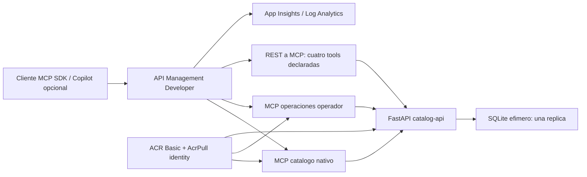

# Arquitectura y decisiones

Narrativa: descubrir herramientas, gobernar acceso, observar y limitar. Dominio neutral: catalogo corporativo con payments, inventory, orders, identity y shipping. Todos los propietarios, consumidores, solicitudes y SLA son ficticios. Ninguna evaluacion concede aprobacion real.

## Propiedad tecnica

- Nativo: las tools y sus schemas viven en Python SDK oficial. APIM gobierna el servidor completo, no se atribuye RBAC por herramienta.
- REST-backed: APIM implementa MCP y mapea cuatro tool resources a operaciones OpenAPI reales. No se importa la mutacion como tool. La API REST tiene una policy que deniega metodos distintos de GET.
- Ambos consultan la misma API por red. No existen datos fallback hardcoded en los servidores MCP.
- Plano de control: Terraform, ARM, ACR build; plano de datos: cliente, gateway, ACA, API.
- Aspire 13.6.0 es solo desarrollo local. Terraform es la unica configuracion cloud. No se ejecuta `aspire deploy` ni `azd up`.

## Estado y concurrencia

SQLite con primary key derivada de SHA-256 de la solicitud validada, transaccion por conexion y timeout. Solicitudes repetidas generan el mismo ID: primera 201, repetidas 200. Hay prueba concurrente con ocho solicitudes. El catalogo usa una sola replica y modo de revision Single. No garantiza persistencia entre revisiones/reinicios, ni continuidad durante despliegues; la respuesta lo declara. No usar esta arquitectura para aprobaciones reales. La fuente de datos read-only es determinista y se restaura al arrancar.

Los MCP son stateless y pueden escalar 1-2 replicas. POST no se reintenta automaticamente; GET tiene hasta tres intentos con backoff. La idempotencia del registro solo existe mientras la SQLite correspondiente conserve su estado. Para produccion: datastore durable compartido, claves idempotentes explicitas, migraciones, auditoria y aprobacion humana.

## Seguridad

Claves APIM por producto reader y operator. El reader solo tiene catalogo nativo y REST-backed; el operator solo el servidor de operaciones. Ademas, policy verifica Product.Id. La separacion es de servidores/productos, no RBAC individual de tools. El operador puede evaluar y registrar, y no se convierte por ello en reader de otras APIs APIM.

Origen ACA publico con HTTPS y secreto fuerte de 48 caracteres inyectado desde Terraform como secret ACA y named value APIM secret. Compromiso didactico: no red privada ni Entra integrado. Health es publico pero no ofrece herramientas ni datos de negocio. El catalogo exige read para GET y write para registro. MCP catalogo no recibe write; MCP operaciones recibe read downstream y write. OriginAuth falla al arrancar cloud sin secretos. Se valida comparacion constante; nunca aceptar una clave APIM como credencial de origen.

## Versiones y discrepancias observadas

Python host 3.11.2 / imagen 3.11.14; MCP 1.30.0 maintenance; protocolo local negociado 2025-11-25. Root uv.lock es el lock compartido autoritativo; los pyproject por servicio documentan la superficie, no mantienen ambientes diferentes. Cada Dockerfile usa contexto root y copia solo app/shared, usuario 10001 y probe /health.

OpenAPI runtime FastAPI 3.1 se exporta estructuralmente a 3.0.3 para APIM: anyOf null -> nullable, const -> enum. Operation IDs estables. El contrato ilustrativo de cada servicio no es una API de negocio implementada.

AzureRM 5.9.0 exige logs_destination explicito. SDK Host allowlist debe incluir FQDN sin puerto ademas de fqdn:*. APIM exige ID REST canonico sin ;rev=1 para tools. If-Match=* y locks serializan tools. ARM real de passthrough exige endpoints como diccionario aunque Learn describe array: schema_validation_enabled=false se limita al recurso nativo. Asociaciones producto/API usan AzureRM porque GET singleton preview devolvio 405 con AzAPI. Estas discrepancias se prueban con ARM y no se ocultan.

APIM Developer puede tener downtime de administracion: se observo 409 ManagementApiRequestFailed. Reanudar contra mismo state, nunca sustituirlo por otra SKU sin decision de coste. Normalizacion de XML en APIM puede producir drift de formato; no se permite ignorar silenciosamente cambios de seguridad.