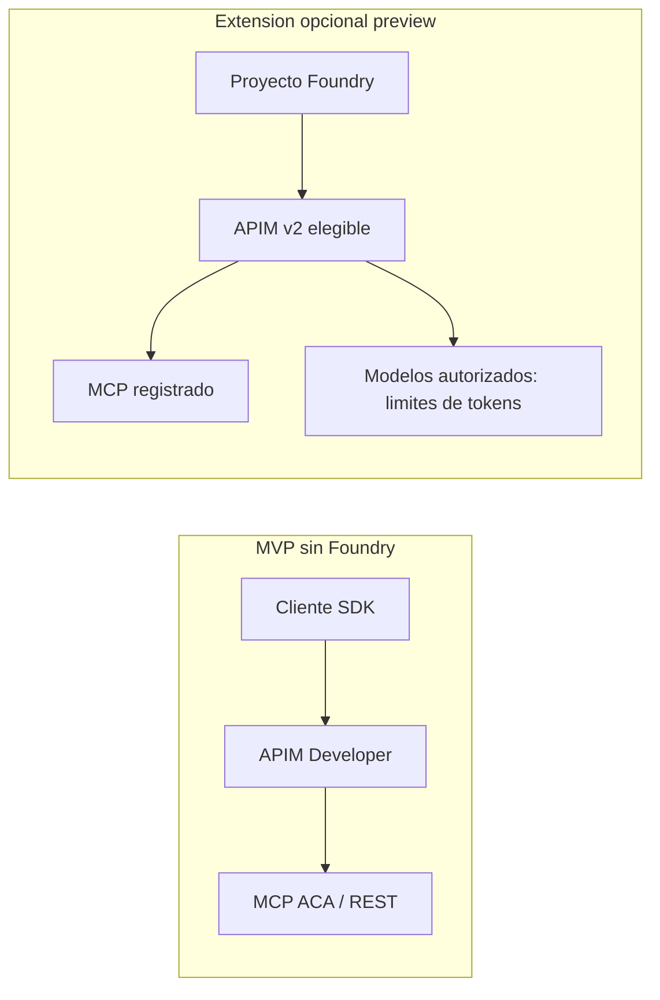

# Foundry opcional: alcance verificado, no desplegado

El MVP funciona sin LLM comercial, Foundry ni Copilot. AI Gateway son capacidades de Azure API Management, no un recurso adicional independiente. La integracion de Foundry es preview y tiene condiciones distintas a los MCP de APIM Developer.

Fuentes consultadas 2026-10-12:

- https://learn.microsoft.com/en-us/azure/foundry/configuration/enable-ai-api-management-gateway-portal
- https://learn.microsoft.com/en-us/azure/foundry/agents/how-to/tools/governance
- https://learn.microsoft.com/en-us/azure/api-management/genai-gateway-capabilities

## Requisitos y pasos documentados

No se ejecutaron estos pasos en el portal ni se creo Foundry. Son procedimientos documentales, no evidencia live.

1. Foundry resource autorizado, mismo tenant y misma suscripcion que APIM.
2. APIM v2 elegible; Developer de este taller NO aparece como instancia asociable. Crear desde portal usa Basic v2. Recalcular coste y desplegar instancia adicional explicitamente autorizada, o elegir v2 antes del primer despliegue. No reconfigurar destructivamente la instancia principal.
3. Contributor/Owner del RG para crear APIM, APIM Service Contributor/Owner de instancia existente, y Foundry Account Owner/Owner segun la operacion.
4. En Foundry nuevo: Manage > AI Gateway > Add AI Gateway, elegir recurso Foundry y Use existing APIM v2.
5. Verificar estado Enabled. Proyectos nuevos se habilitan por defecto; existentes deben agregarse conscientemente.
6. Configurar token quotas/TPM por proyecto y modelo. No confundir esos tokens con rate-limit-by-key de llamadas herramientas; no crear un deployment LLM de pago para demostrar MCP.
7. Nuevas herramientas MCP creadas tras asociar gateway, sin managed OAuth, pueden mediarse. Confirmar que endpoint mostrado sea el del gateway, no URL directa.
8. Aplicar policies mediante Azure APIM, no atribuir un editor de policies al portal Foundry. Probar con consumidor aprobado y verificar APIM logs/metrics.

Limitaciones reales: herramientas existentes no se reencaminan automaticamente; managed OAuth, OpenAPI tools, SharePoint y code-first MCP tools no elegibles segun guia consultada. Foundry AI Gateway no registra tool traces; usar APIM/backend observability. Registro de agentes del control plane es capacidad adicional documentada, no requisito de este taller ni RBAC individual de tools.

Foundry privado exige conectividad privada compatible (Standard/Premium v2 segun configuracion). Basic v2 no sustituye todas las opciones de red. Las condiciones y screenshots de preview pueden cambiar.

Coste: no extrapolar Developer a Basic v2; consultar pricing regional/calculadora y oferta. Deshabilitar un proyecto Foundry no elimina APIM ni deja de cobrar. Eliminar asociacion y APIM dedicado solo tras revisar dependencias y permiso de destruccion. Estado extension: BLOCKED/NO EJECUTADA por alcance deliberado, no fallo del MVP.