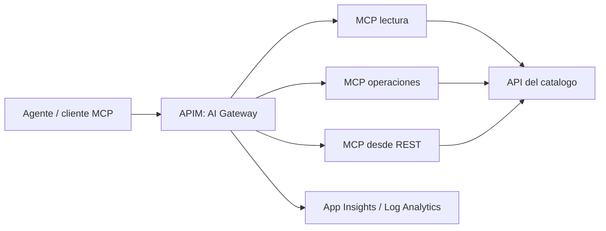

<!--
Preparacion del ponente, fuera de los 45 minutos:

1. Abrir una terminal en la raiz apiaddicts-2026-mcp-workshop. Todos los comandos
  siguientes parten de esa carpeta, no de docs ni de scripts.
2. Tener Azure desplegado y validado previamente. No ejecutar deploy --apply,
  cambiar SKU/suscripcion ni destruir recursos durante la charla. No depender
  del provisioning de APIM para iniciar la demo.
3. Arrancar ./scripts/demo/local.sh en una terminal y mantener Aspire activo.
  En otra, ejecutar ./scripts/tests/test-local.sh --smoke. Confirmar tres
  contenedores healthy; abrir http://localhost:15888 y http://localhost:8001/docs.
  Resolver el token local del dashboard antes de proyectar, sin compartirlo.
4. Validar cloud antes de la sesion: ./scripts/tests/test-backends.sh y
  ./scripts/tests/test-azure.sh. Este ultimo registra una solicitud ficticia;
  no es una comprobacion exclusivamente read-only. Revisar su resultado antes
  de continuar. No ejecutar estas validaciones desde las notas por accidente.
5. Comprobar ./scripts/demo/demo.sh --step cloud y ./scripts/demo/observe.sh.
  Un BLOCKED se explica, no se oculta. Consultar docs/EVIDENCE.md para contexto
  historico y conservar fecha/entorno al mostrar cualquier resultado guardado.
6. Tener abiertas solo las vistas a proyectar: presentacion, terminal de demo,
  Aspire, OpenAPI y evidencia revisada. Si se usa Azure Portal, dejar el recurso
  APIM y el workspace correcto abiertos; evitar navegar por cuentas ajenas.
7. Preparar los snapshots locales docs/fixtures/local-tools-8002.json y
  docs/fixtures/local-tools-8003.json como respaldo. Revisar previamente toda
  salida guardada: no abrir state, tfvars, credenciales ni .local completa.
8. Usar terminal interactiva con letra legible y sin --json. Los resultados SDK
  redactados quedan en .local/demo-results; no es necesario abrirlos en vivo.
  No repetir llamadas compulsivamente: consumen la ventana de rate limit.
9. Activar cronometro: 14 slides, 45 minutos. Los separadores --- pertenecen a
  las slides; estas notas HTML quedan ocultas en la vista Markdown renderizada.
  Si falta tiempo, recortar navegacion y preguntas intermedias, no las reservas
  de seguridad ni la distincion entre evidencia historica y ejecucion live.
-->

# TALLER: Como usar agentes MCP para construir un catalogo gobernado, seguro y de alto rendimiento

**De encontrar una API a consumirla con control y evidencia.**

APIAddicts 2026 | Taller practico | 45 minutos

Descubrir -> Gobernar -> Observar y limitar

<!-- Slide 1 | Tiempo: 1 min.
Ventana del taller: 00:00-01:00.

1. [00:00-00:20] Mostrar solo la portada. Abrir: "Tenemos un agente capaz de
  encontrar APIs. Ahora necesitamos poder confiar en lo que hace".
2. [00:20-00:40] Presentar el objetivo: encontrar un servicio, encauzar una
  solicitud de acceso y comprobar limites y trazabilidad sobre el mismo catalogo.
3. [00:40-01:00] Anticipar las tres demos: descubrir en local, gobernar en cloud,
  observar y limitar. Aclarar que el cliente usa el SDK MCP y no requiere un LLM.

No ejecutar comandos ni explicar todavia componentes de Azure.
Transicion: "Antes de elegir tecnologia, veamos el problema del equipo".
-->

---

## 2. Todo empieza con una pregunta

> "Nuestro equipo necesita integrar pagos. Que API usamos y como accedemos?"

- La documentacion existe, pero cuesta encontrar propietario y contrato.
- Dar credenciales al agente no define que puede hacer.
- Una integracion que funciona una vez no demuestra capacidad.

**El problema no es llamar una API: es consumirla con confianza.**

<!-- Slide 2 | Tiempo: 2 min.
Ventana del taller: 01:00-03:00.

1. [00:00-00:30] Introducir al protagonista: "El equipo checkout necesita
  integrar pagos. Sabe que existe una API, pero no cual es la correcta".
2. [00:30-00:50] Preguntar: "Quien ha tenido que buscar al propietario de una
  API por chat?". Admitir una respuesta breve, sin abrir debate.
3. [00:50-01:20] Recorrer los tres problemas: descubrir el contrato correcto,
  obtener permiso y operar sin saturar. Relacionar cada uno con una consecuencia:
  tiempo perdido, acceso excesivo e incidencias sin diagnostico.
4. [01:20-01:40] Decir: "Un prompt que pida portarse bien no impide llamar una
  herramienta de escritura. El control debe ser exigido por la plataforma".
5. [01:40-02:00] Delimitar el caso: payments, equipos, propietarios y SLA del
  dataset son ficticios; no vamos a integrar una pasarela de pago real.

Mostrar la pregunta de la slide; no abrir aun terminal ni portal.
Transicion: "Traduzcamos esa necesidad en tres capacidades comprobables".
-->

---

## 3. El viaje que vamos a construir

| Necesidad del equipo | Respuesta de la plataforma |
|---|---|
| Encontrar la API adecuada | Catalogo y contrato descubribles |
| Solicitar acceso sin saltarse controles | Lectura y operaciones separadas |
| Consumir sin saturar ni perder trazabilidad | Gateway, limites y telemetria |

**Por que:** confianza. **Que:** catalogo gobernado. **Como:** MCP + AI Gateway.

<!-- Slide 3 | Tiempo: 2 min.
Ventana del taller: 03:00-05:00.

1. [00:00-00:35] Leer la tabla por filas, no por columnas: una necesidad del
  equipo y la respuesta concreta que debe ofrecer la plataforma.
2. [00:35-01:00] Fijar la primera evidencia: el cliente descubre herramientas
  tipadas y obtiene informacion real del catalogo demo.
3. [01:00-01:25] Fijar la segunda: un consumidor autorizado puede leer, pero un
  anonimo o un reader intentando operar reciben un rechazo verificable.
4. [01:25-01:45] Fijar la tercera: el exceso de llamadas produce 429 y, despues
  de la ventana, una llamada valida vuelve a funcionar; hay trazas consultables.
5. [01:45-02:00] Resumir: "Por que: confianza. Que: un catalogo gobernado.
  Como: contratos MCP, un gateway y evidencia, no solo una demo feliz".

No prometer aprobacion empresarial, throughput ni ausencia total de errores.
Transicion: "Que aporta exactamente MCP a este recorrido?".
-->

---

## 4. MCP conecta; no autoriza

```text
Agente / cliente -> initialize -> tools/list -> tools/call
```

- El servidor publica herramientas con nombres, descripciones y schemas.
- La API conserva los datos y las reglas de negocio.
- El cliente descubre y llama; la plataforma decide el acceso.

**MCP no sustituye autenticacion, autorizacion ni aprobacion humana.**

<!-- Slide 4 | Tiempo: 3 min.
Ventana del taller: 05:00-08:00.

1. [00:00-00:40] Senalar initialize: "Cliente y servidor negocian el protocolo
  y las capacidades antes de usar herramientas".
2. [00:40-01:15] Senalar tools/list: el cliente obtiene nombres, descripciones,
  schemas y annotations. Ese contrato permite saber que argumentos enviar.
3. [01:15-01:45] Senalar tools/call: el cliente invoca una herramienta concreta;
  el servidor consulta la API del catalogo y devuelve su resultado.
4. [01:45-02:15] Separar responsabilidades: el agente elige una accion; MCP la
  comunica; el backend conserva las reglas; gateway y origen exigen permisos.
5. [02:15-02:40] Aclarar: "Hoy usamos un cliente determinista con el SDK oficial
  y Streamable HTTP. Probamos integracion y controles, no razonamiento autonomo".
6. [02:40-03:00] Repetir el limite: descubrir una herramienta no concede permiso
  para usarla ni equivale a aprobar acceso a una API de negocio.

Mantener la vista en la secuencia de la slide. No mostrar JSON-RPC manual.
Transicion: "Ahora coloquemos estas responsabilidades en la arquitectura".
-->

---

## 5. Una fuente de verdad, una puerta de entrada



Aspire en local; Azure Container Apps en cloud; Terraform para infraestructura.

**El gateway gobierna el acceso; el catalogo conserva el dominio.**

<!-- Slide 5 | Tiempo: 3 min.
Ventana del taller: 08:00-11:00.

1. [00:00-00:45] Recorrer el diagrama de izquierda a derecha: cliente, APIM,
  dos servidores MCP nativos y fachada MCP desde REST, API del catalogo.
2. [00:45-01:10] Senalar la convergencia en la API: "Los caminos consultan el
  mismo dataset por red; no hay un catalogo distinto para cada demo".
3. [01:10-01:30] Senalar telemetria: APIM envia observabilidad a App Insights /
  Log Analytics. Terraform configura cloud; Aspire solo orquesta desarrollo local.
4. [01:30-02:20] Cambiar al dashboard http://localhost:15888 ya abierto. Mostrar
  los tres servicios healthy y su relacion. No detenerlos ni abrir secretos.
5. [02:20-02:40] Explicar: "En local llamaremos directamente a los MCP. APIM
  aparece en cloud; ejecutar local no demuestra las policies del gateway".
6. [02:40-03:00] Volver a la slide y destacar la fuente de verdad del dominio.

Plan B: si el dashboard falla, mantener el diagrama y declarar la limitacion;
no invertir estos tres minutos en reiniciar infraestructura.
Transicion: "Vamos a descubrir el catalogo desde un cliente real".
-->

---

## 6. Demo 1: encontrar antes de integrar

> "Busco payments. Quiero saber quien lo mantiene y que contrato ofrece."

```bash
./scripts/demo/demo.sh --step discover
```

- Descubrimos **4 herramientas de lectura** y **2 de operaciones**.
- Buscamos `payments` y consultamos un contrato de ejemplo (`orders`).
- Verificamos que hay contratos tipados, no respuestas inventadas.

**Ya encontramos el servicio. Todavia no tenemos permiso para operarlo.**

<!-- Slide 6 | Tiempo: 6 min.
Ventana del taller: 11:00-17:00.

1. [00:00-00:30] Ir a la terminal de demo situada en la raiz. Decir: "Checkout
  pregunta por payments; primero descubriremos el contrato de las herramientas".
2. [00:30-01:15] Ejecutar una vez: ./scripts/demo/demo.sh --step discover.
  El script lista el MCP lector, busca payments, obtiene el contrato de orders
  y lista operaciones. Dejarlo terminar; explicar despues, sin relanzarlo.
3. [01:15-02:15] Recorrer la salida de initialize y tools/list del lector.
  Senalar las cuatro herramientas, un schema de entrada y una annotation.
  Explicar que son datos publicados por el servidor, no texto inventado por un LLM.
4. [02:15-03:00] Mostrar search_services con query=payments. Identificar el
  servicio y su propietario ficticio; recordar que cualquier SLA es de ejemplo.
5. [03:00-03:45] Mostrar get_service_contract con service_id=orders. Decir
  explicitamente: "El guion usa orders para el contrato; no hemos obtenido el
  de payments en esta llamada. Estamos mostrando el mismo patron de consulta".
6. [03:45-04:30] Mostrar las dos herramientas del servidor de operaciones.
  Solo se listan aqui: no se evalua ni registra una solicitud en esta demo.
  Local no tiene la autenticacion cloud, por lo que no prueba la separacion APIM.
7. [04:30-05:20] Abrir http://localhost:8001/docs. Mostrar una operacion del
  catalogo y su schema. Distinguir OpenAPI real del catalogo de los contratos
  ilustrativos de los servicios: no estamos ejecutando una API de pagos u orders.
8. [05:20-06:00] Volver a la slide: "Ya sabemos que servicio existe y que
  herramientas podemos descubrir. Nos falta controlar quien puede usarlas".

Resultado esperado: cuatro tools lectoras, dos de operaciones y llamadas validas.
Plan B: abrir docs/fixtures/local-tools-8002.json y local-tools-8003.json;
etiquetarlos como snapshots locales. No atribuirles resultados de search/call ni
presentarlos como cloud. Si falla la llamada, declarar FAIL/BLOCKED y continuar.
Transicion: "Podemos publicar este contrato de dos formas".
-->

---

## 7. Dos caminos para publicar herramientas

| MCP nativo | MCP desde REST |
|---|---|
| Python define herramientas y schemas | APIM mapea operaciones OpenAPI seleccionadas |
| Control del contrato en el servidor | Reutilizacion de APIs existentes |
| Adecuado para herramientas de dominio | Adecuado para una exposicion acotada |

**Mismo catalogo, distinta propiedad del contrato.**

No exponemos toda la API automaticamente ni convertimos mutaciones en herramientas lectoras.

<!-- Slide 7 | Tiempo: 3 min.
Ventana del taller: 17:00-20:00.

1. [00:00-00:40] Explicar la columna nativa: las tools y sus schemas viven en
  Python; APIM publica y gobierna ese servidor existente.
2. [00:40-01:20] Explicar la columna REST: APIM implementa la fachada MCP y
  mapea cuatro operaciones OpenAPI seleccionadas. No es importar toda la API.
3. [01:20-01:50] Dar el criterio de eleccion: "Si mantenemos herramientas de
  dominio, nativo; si reutilizamos operaciones existentes y acotadas, REST-backed".
4. [01:50-02:20] Advertir que ambos leen el mismo catalogo, pero schemas y
  annotations pueden diferir porque tienen propietarios tecnicos distintos.
5. [02:20-02:45] Si se preparo esta vista, mostrar en APIM los mappings de
  tools a operaciones REST seleccionadas; de lo contrario, usar la tabla.
  No crear ni modificar recursos ni lanzar una exportacion live.
6. [02:45-03:00] Aclarar que la equivalencia de get_service(payments) se verifica
  en test-azure; el siguiente comando cloud solo mostrara descubrimiento.

No ejecutar comandos en esta slide ni afirmar RBAC nativo por herramienta.
Transicion: "Sea cual sea el camino, necesitamos el mismo punto de control".
-->

---

## 8. AI Gateway: el control no vive en el prompt

**APIM es el AI Gateway de este taller.**

- Producto `reader`: catalogo nativo y MCP desde REST.
- Producto `operator`: servidor MCP de operaciones.
- Claves por consumidor; cuotas de llamadas y telemetria centralizadas.

**La separacion es por servidor y producto, no RBAC por herramienta.**

<!-- Slide 8 | Tiempo: 3 min.
Ventana del taller: 20:00-23:00.

1. [00:00-00:35] Decir: "AI Gateway es el papel que cumple APIM en esta
  arquitectura, no un recurso adicional ni un permiso concedido por el prompt".
2. [00:35-01:15] Senalar reader: permite usar el MCP catalogo nativo y la fachada
  MCP desde REST. Asociarlo al equipo que busca informacion para integrar payments.
3. [01:15-01:55] Senalar operator: permite usar el servidor de operaciones.
  No convierte automaticamente al consumidor en reader de los otros servidores.
4. [01:55-02:20] Explicar que las claves corresponden a suscripciones/productos
  APIM y que las policies exigen esa separacion en cada servidor.
5. [02:20-02:40] Mostrar el limite de la implementacion: no hay roles individuales
  por tool. Si cambia la granularidad requerida, hay que redisenar el control.
6. [02:40-03:00] Distinguir contadores: aqui limitamos llamadas MCP, no tokens
  LLM. No hay Foundry ni modelos desplegados como dependencia de este recorrido.

No abrir claves de producto ni pantallas de credenciales para explicarlo.
Transicion: "Vamos a ver acceso permitido y evidencia de acceso rechazado".
-->

---

## 9. Demo 2: demostrar tanto el si como el no

```bash
./scripts/demo/demo.sh --step cloud
```

| Intento | Resultado verificado en el taller |
|---|---|
| Lectura con `reader` | Acceso al catalogo por ambos caminos |
| Acceso anonimo | Rechazado |
| `reader` contra operaciones | Rechazado |
| Registro con `operator` | Solicitud ficticia `demo-pending` |

**Registrar una solicitud no significa aprobar el acceso.**

<!-- Slide 9 | Tiempo: 6 min.
Ventana del taller: 23:00-29:00.

1. [00:00-00:30] Ir a la terminal y avisar: "La primera parte es descubrimiento
  live por APIM; despues veremos resultados de seguridad verificados previamente".
2. [00:30-01:30] Ejecutar una vez: ./scripts/demo/demo.sh --step cloud.
  El script valida la suscripcion, obtiene claves en memoria y ejecuta
  initialize/tools/list en los endpoints con el producto correspondiente.
3. [01:30-02:30] Senalar cuatro tools del catalogo nativo, cuatro REST-backed
  y dos de operaciones. Comparar nombres y schemas sin exigir igualdad exacta.
  No decir que este comando invoca get_service o prueba rechazos: solo lista tools.
4. [02:30-03:15] Abrir la evidencia revisada de ./scripts/tests/test-azure.sh,
  ejecutado antes de la charla. Mostrar fecha y entorno. En docs/EVIDENCE.md,
  AZ-02 documenta equivalencia; SEC-01 y SEC-02 documentan acceso y separacion.
  Distinguir esa evidencia historica del resultado live que acaba de terminar.
5. [03:15-04:00] Recorrer la tabla: reader obtiene acceso al catalogo; anonimo
  recibe 401; reader contra operaciones recibe 401. El rechazo es el resultado
  correcto del control, no una averia de la herramienta.
6. [04:00-04:50] Mostrar el registro de la solicitud con operator: estado
  demo-pending. Explicar que evaluate_access_request devuelve approved=false;
  ni evaluar ni registrar concede acceso real a payments.
7. [04:50-05:30] Senalar la equivalencia comprobada de get_service(payments)
  en ambos caminos, y relacionarla con la misma API y fuente de datos.
8. [05:30-06:00] Volver a la slide: "Probar seguridad exige probar tambien el
  no. Registrar una intencion no equivale a aprobarla".

No repetir test-azure en vivo: incluye mutacion ficticia y esperas de rate limit.
Si se quiere ejecutarlo en otra sesion, hacerlo desde raiz y reservar tiempo.
Plan B: si cloud falla, explicar el bloqueo y mostrar solo evidencia fechada
como historica. No usar los fixtures locales como demostracion de APIM ni cambiar
suscripcion/SKU para salvar la demo. No imprimir claves para depurar.
Transicion: "Aun queda una pregunta: que pasa si alguien evita el gateway?".
-->

---

## 10. Poner un gateway delante no cierra la puerta de atras

```text
Cliente -> APIM autentica y limita -> Origen exige su propia credencial
```

- ACA sin credencial de origen rechaza acceso a datos y MCP.
- Lectura y escritura usan permisos de backend separados.
- Secretos fuera de slides, logs y repositorio; payloads no registrados.

**Taller:** HTTPS + secreto compartido. **Produccion:** identidad y red restringida.

<!-- Slide 10 | Tiempo: 3 min.
Ventana del taller: 29:00-32:00.

1. [00:00-00:35] Plantear el bypass: "Si conozco la URL publica de ACA, puedo
  evitar las policies de APIM? Poner un gateway delante no basta para impedirlo".
2. [00:35-01:15] Recorrer la cadena: cliente con clave de producto, APIM que
  valida y limita, origen que exige su propia credencial distinta de la clave APIM.
3. [01:15-02:00] Mostrar SEC-03 en docs/EVIDENCE.md o el resultado revisado de
  ./scripts/tests/test-backends.sh. Sin token origen, datos y MCP responden 401;
  health responde 200. Ese health publico no concede acceso a herramientas.
4. [02:00-02:25] Explicar permisos downstream: lectura y escritura separadas.
  No mostrar el secreto compartido ni cabeceras autenticadas para demostrarlo.
5. [02:25-02:45] Aclarar el compromiso: HTTPS y secreto de origen, pero endpoint
  publico; no hay red privada ni Entra integrado. Produccion necesita un modelo
  de identidad, red y rotacion de credenciales acorde al riesgo.
6. [02:45-03:00] Volver a la slide y cerrar: "Protegemos el gateway y el origen".

La validacion de backends se hace antes del taller, no se vuelve a lanzar aqui.
Plan B: explicar el procedimiento pendiente si falta evidencia; no marcar PASS.
Transicion: "El acceso esta controlado. Ahora veamos como protegemos capacidad".
-->

---

## 11. Demo 3: un consumidor insiste, la plataforma protege

```bash
./scripts/demo/demo.sh --step govern
```

```text
Llamadas aceptadas -> 429 esperado -> Esperar ventana -> Exito de nuevo
```

- Limite configurado: **5 llamadas / 30 segundos** por suscripcion y API.
- Carga acotada, sin mutaciones y con concurrencia 1.
- Verificamos proteccion **y recuperacion**, no solo el rechazo.

**Un 429 esperado es un control funcionando; un error inesperado sigue siendo un fallo.**

<!-- Slide 11 | Tiempo: 6 min.
Ventana del taller: 32:00-38:00.

1. [00:00-00:30] Presentar el experimento: "Un consumidor insiste. Queremos
  ver proteccion y recuperacion, no medir la capacidad maxima de Azure".
2. [00:30-01:15] Ejecutar una vez: ./scripts/demo/demo.sh --step govern.
  Obtiene la clave reader en memoria y espera una ventana limpia; por defecto
  la cuenta atras es de 31 segundos. No interrumpir esa espera ni lanzar otro cliente.
3. [01:15-02:30] Observar el burst acotado de get_service(payments), con
  concurrencia 1 y sin mutaciones. Senalar respuestas aceptadas y 429 como WARN.
  No prometer exactamente cinco llamadas de negocio exitosas: initialize y
  otras peticiones MCP tambien consumen limite y el contador no es exacto.
4. [02:30-03:30] Durante la segunda espera, explicar la clave del contador:
  suscripcion + API, no IP compartida. Recordar la configuracion de 5/30s y que
  el presupuesto de prueba es acotado, no una carga abierta contra el servicio.
5. [03:30-04:15] Senalar la llamada de recuperacion: tras la ventana vuelve a
  funcionar. Si no sucede, la prueba falla; no presentar el 429 aislado como exito.
6. [04:15-05:00] Mostrar successful_samples y p50/p95 del resultado GOV-LOAD.
  Se mide initialize + tools/call wall-clock solo en exitos, incluida recuperacion;
  el umbral indicativo no es SLA y la muestra pequena no permite prometer TPS.
7. [05:00-05:30] El mismo comando consulta KQL al terminar la carga. Separar
  el resultado GOV-LOAD del de observabilidad: puede funcionar el control y
  faltar aun telemetria por retraso de ingestion.
8. [05:30-06:00] Volver a la slide y dar la pauta de cliente: backoff, respetar
  Retry-After cuando exista y no reintentar mutaciones ciegamente.

Los tiempos de arriba son presupuesto para explicar, no una duracion garantizada
del comando. No relanzarlo para buscar una salida mas bonita ni elevar el limite.
Plan B: mostrar evidencia guardada de GOV-LOAD con fecha/entorno. Si el burst
falla, declararlo; si solo falla KQL, distinguir el bloqueo OBS de la recuperacion.
Transicion: "Tenemos control y recuperacion. Que podemos observar por herramienta?".
-->

---

## 12. Sin evidencia, solo tenemos una impresion

```bash
./scripts/demo/observe.sh
```

```kusto
AppRequests
| where TimeGenerated > ago(24h)
| where Properties["network.protocol.name"] == "MCP"
| where Properties["gen_ai.operation.name"] == "tools/call"
| project TimeGenerated, tool=Properties["gen_ai.tool.name"],
          DurationMs, ResultCode, OperationId
| take 10
```

**Herramienta, duracion, resultado y correlacion; no secretos ni payloads.**

<!-- Slide 12 | Tiempo: 3 min.
Ventana del taller: 38:00-41:00.

1. [00:00-00:30] Si govern ya mostro filas, reutilizar esa salida. Si la
  ingestion estaba pendiente, ejecutar una vez ./scripts/demo/observe.sh;
  no hace falta repetir la carga para explicar las trazas.
2. [00:30-01:10] Senalar en una fila real: herramienta, timestamp, DurationMs,
  ResultCode y OperationId. Explicar para que sirve cada dato al investigar
  una llamada lenta o un error, sin abrir argumentos ni resultados de negocio.
3. [01:10-01:50] Volver a la KQL de la slide: AppRequests pertenece al workspace;
  filtrar network.protocol.name=MCP y gen_ai.operation.name=tools/call.
  No mezclar nombres de esta tabla con requests de App Insights clasico.
4. [01:50-02:15] Si Azure Monitor Logs esta preparado, seleccionar el workspace
  del taller y usar la query revisada en docs/queries/workspace.kql. Esta
  navegacion es opcional: omitirla si la terminal ya muestra la evidencia.
5. [02:15-02:40] Distinguir duracion del gateway de wall-clock del cliente:
  miden tramos diferentes, por lo que no se comparan como el mismo percentil.
  Un servidor stateless puede no tener session ID; no inventar esa correlacion.
6. [02:40-03:00] Cerrar: "Observabilidad es evidencia util, no capturar todo.
  Aqui no registramos payloads ni secretos para obtener estas metricas".

Resultado esperado: filas reales con nombre de herramienta. Query valida sin
filas significa BLOCKED, no PASS. Si hay retraso, mostrar una captura historica
revisada y fechada; si no existe, explicar el procedimiento pendiente y seguir.
Transicion: "Ahora podemos medir; falta saber que conclusiones son defendibles".
-->

---

## 13. Alto rendimiento: disenar y medir, no prometer

| En este taller | Para sostener carga real |
|---|---|
| p50/p95 con pocas muestras | Carga representativa, concurrencia y errores |
| MCP stateless; replicas acotadas | Escalado y cold starts medidos |
| SQLite efimera; catalogo a una replica | Almacen durable e idempotencia compartida |
| APIM Developer sin SLA | Capacidad y disponibilidad acordes al servicio |

**Dos exitos no son un benchmark. Un percentil no demuestra capacidad.**

<!-- Slide 13 | Tiempo: 2 min.
Ventana del taller: 41:00-43:00.

1. [00:00-00:30] Empezar por la reserva: "Hemos demostrado controles y una
  medicion acotada; no hemos demostrado capacidad de produccion ni un SLA".
  No leer p95 como garantia si procede de solo dos exitos.
2. [00:30-01:00] Recorrer las dos primeras filas: para evaluar rendimiento real,
  definir carga, concurrencia, latencia de cola, errores y cold starts; medir
  el escalado de los MCP stateless con un presupuesto controlado.
3. [01:00-01:25] Recorrer SQLite: catalogo a una replica y estado efimero.
  La deduplicacion dura mientras exista esa base; produccion requiere almacen
  durable compartido e idempotencia que sobreviva a replicas y revisiones.
4. [01:25-01:45] Recorrer APIM Developer: sirve al taller, no tiene SLA.
  Elegir capacidad y disponibilidad por requisitos y coste, no por la demo.
5. [01:45-02:00] Anadir que las aprobaciones reales necesitan auditoria y flujo
  humano. Dar el criterio: "Primero objetivos y riesgos, despues carga y evidencia".

No lanzar tests de carga nuevos, cambiar replicas ni recomendar una SKU concreta.
Transicion: "Cerremos volviendo a la pregunta del equipo checkout".
-->

---

## 14. El equipo ya no busca a ciegas

> "Encontramos payments, entendemos su contrato, solicitamos acceso y podemos comprobar los controles."

- **Por que:** consumir APIs con confianza, no solo conectarlas.
- **Que:** catalogo descubrible, acceso gobernado y evidencia operativa.
- **Como:** MCP + gateway + origen protegido + medicion.

**MCP abre la conversacion. La plataforma pone las reglas. La evidencia demuestra que funcionan.**

[Codigo y arranque](../README.md) | [Guion de demos](DEMO_SCRIPT.md) | [Evidencia del taller](EVIDENCE.md)

<!-- Slide 14 | Tiempo: 2 min.
Ventana del taller: 43:00-45:00.

1. [00:00-00:25] Leer la frase del equipo y matizar oralmente: "El patron nos
  permite consultar contratos; hoy la llamada de contrato fue para orders y
  el registro de acceso es evidencia previa. No hemos aprobado payments".
2. [00:25-00:50] Resumir el arco: empezamos buscando una API, descubrimos
  herramientas, controlamos lectura/operacion y verificamos limite y recuperacion.
3. [00:50-01:10] Repetir por que/que/como y la frase final. Proponer un siguiente
  paso concreto: elegir una API propia, exponer pocas operaciones y definir
  permisos, origen protegido y metricas antes de conectar un agente autonomo.
4. [01:10-01:25] Senalar los enlaces a codigo, guion y evidencia. Aclarar que
  Foundry es opcional y no desplegado; no abrir otra demo ni provisionar modelos.
5. [01:25-01:40] Recordar el cierre operativo: APIM cobra aunque no haya trafico;
  TTL no elimina recursos. Cleanup solo despues del taller con confirmacion
  explicita del propietario, RG y suscripcion; no ejecutar destroy al proyectar.
6. [01:40-02:00] Admitir una pregunta breve o dejar una pregunta final al publico:
  "Que API de vuestra plataforma expondriais primero y con que permisos?".

No terminar afirmando que el taller esta listo para produccion.
Ultima frase: "MCP abre la conversacion. La plataforma pone las reglas.
La evidencia demuestra que funcionan".
-->